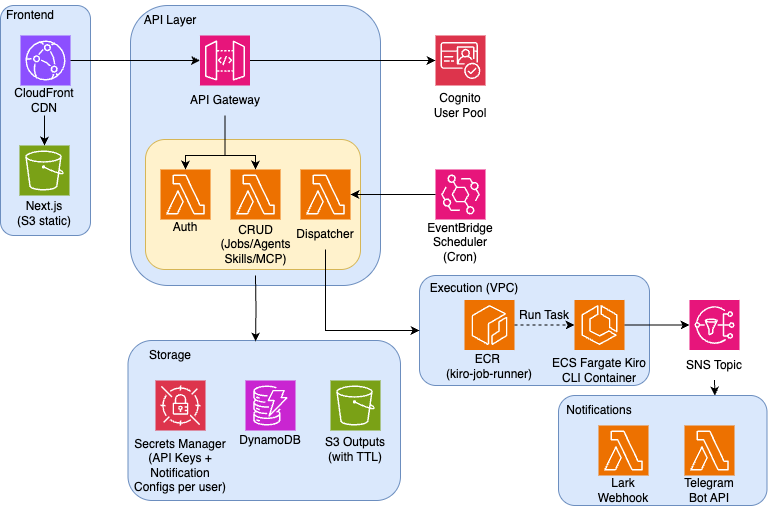
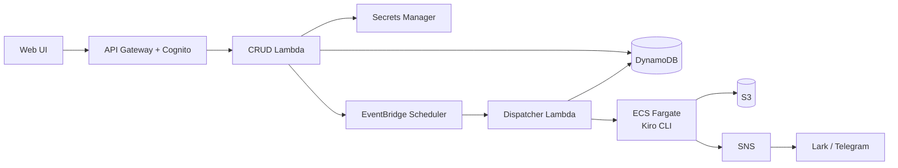

# Kiro CLI Job Scheduler

English | [中文](README.zh-CN.md)

A server-based orchestration platform for scheduling and executing [Kiro CLI](https://kiro.dev/cli/) tasks. Define agents with custom prompts, skills, and MCP servers, then schedule them to run automatically on AWS managed infrastructure — or locally via Docker Compose.

> [!WARNING]
> This is sample code intended for demonstration and learning purposes only. It is **not intended for production use** as-is, and should be reviewed, tested, and hardened before any production deployment. Deploying this stack creates AWS resources that may incur costs — follow the [Cleanup](#cleanup) steps when you are finished.

## Features

- **Scheduled Jobs** — Cron-style scheduling (e.g., "every weekday at 9am") via AWS EventBridge
- **Agent Configuration** — Define custom agents with prompts, model selection, tools, skills, and MCP servers
- **Skills Management** — Create reusable skill documents (markdown) that can be attached to any agent
- **MCP Servers** — Configure stdio and HTTP MCP servers, reusable across agents
- **Per-user API Keys** — Each user's jobs run under their own KIRO CLI identity (stored in Secrets Manager)
- **Web UI** — Professional dashboard for non-technical users (Next.js + shadcn/ui)
- **Notifications** — Lark webhook and Telegram bot notifications on job completion/failure
- **Local Mode** — Full stack runs locally via Docker Compose with LocalStack

## Architecture





### Job Execution Flow

1. User creates a job via UI (prompt, schedule, agent config)
2. API stores job in DynamoDB, creates EventBridge Schedule
3. At trigger time, EventBridge invokes the Dispatcher Lambda
4. Dispatcher resolves the full agent config (fetches skills, MCP servers)
5. Dispatcher launches an ECS Fargate task with `KIRO_API_KEY` + generated agent JSON
6. Container runs `kiro-cli chat --no-interactive --trust-all-tools --agent job-agent "<prompt>"`
7. On completion, output is uploaded to S3, status updated in DynamoDB
8. SNS notification triggers Lark/Telegram Lambda for user alerts

## Project Structure

```
kiro-job-scheduler/
├── packages/
│   ├── shared/          # TypeScript types + Zod validation schemas
│   ├── api/             # Lambda handlers (auth, CRUD, dispatcher, notifications)
│   ├── web/             # Next.js frontend (App Router + Tailwind)
│   └── infra/           # AWS CDK infrastructure
├── docker/
│   ├── Dockerfile       # Kiro CLI job runner (Amazon Linux 2023)
│   ├── entrypoint.sh    # Job execution script
│   ├── Dockerfile.api   # Local API server
│   └── Dockerfile.web   # Local frontend
├── docker-compose.yml   # Local development stack
└── .github/workflows/   # CI/CD pipeline
```

## Prerequisites

- Node.js 20+
- pnpm 9+
- Docker (for local mode)
- AWS CLI + CDK CLI (for deployment)
- A [Kiro Pro/Pro+/Power](https://kiro.dev/pricing/) subscription (for API key)

## Quick Start (Local Mode)

```bash
# Clone and install
git clone <repo-url> && cd sample-kiro-cli-job-scheduler
pnpm install
pnpm build

# Start local stack (LocalStack + API + Web + Worker)
docker compose up

# Access the UI at http://localhost:3000
```

The local stack uses LocalStack to emulate DynamoDB, S3, Secrets Manager, and SNS. No AWS account required for development.

## AWS Deployment

### 1. Configure AWS credentials

```bash
aws configure  # or use SSO/OIDC
```

### 2. Deploy infrastructure

#### Option A: Terraform (recommended)

```bash
cd terraform
cp terraform.tfvars.example terraform.tfvars  # edit as needed
./deploy.sh
```

**terraform.tfvars options:**

| Variable | Default | Description |
|----------|---------|-------------|
| `region` | `us-east-1` | AWS deployment region |
| `project` | `kiro-scheduler` | Project name prefix (used for all resource names) |
| `environment` | `prod` | Environment identifier |
| `existing_vpc_id` | `""` (empty) | Use an existing VPC. Leave empty to create a new one |
| `existing_subnet_ids` | `[]` (empty) | Subnet IDs in the existing VPC (must have internet egress). Required when `existing_vpc_id` is set |

Example — use an existing VPC:
```hcl
region              = "us-east-1"
project             = "kiro-scheduler"
existing_vpc_id     = "vpc-0123456789abcdef0"
existing_subnet_ids = ["subnet-aaa111", "subnet-bbb222"]
```

`deploy.sh` automates: build project → package Lambda → create Terraform state bucket → deploy infrastructure → build and push Docker image.

#### Option B: CDK

```bash
cd packages/infra
npx cdk bootstrap  # first time only
npx cdk deploy --all
```

This creates:
- 6 DynamoDB tables
- S3 bucket for job outputs (90-day lifecycle)
- ECR repository for the Kiro CLI runner image
- ECS Fargate cluster + task definition
- VPC with public subnets
- Cognito User Pool
- (API Gateway, Lambda functions, EventBridge, SNS are created as part of the stack)

### 3. Build and push the Docker image

```bash
aws ecr get-login-password | docker login --username AWS --password-stdin <account>.dkr.ecr.<region>.amazonaws.com
docker build -t kiro-job-runner -f docker/Dockerfile docker/
docker tag kiro-job-runner <account>.dkr.ecr.<region>.amazonaws.com/kiro-job-runner:latest
docker push <account>.dkr.ecr.<region>.amazonaws.com/kiro-job-runner:latest
```

### 4. Deploy frontend

```bash
cd packages/web

# Create .env.local with values from Terraform outputs
cat > .env.local <<EOF
NEXT_PUBLIC_API_URL=$(cd ../../terraform && terraform output -raw api_endpoint)
NEXT_PUBLIC_COGNITO_USER_POOL_ID=$(cd ../../terraform && terraform output -raw cognito_user_pool_id)
NEXT_PUBLIC_COGNITO_CLIENT_ID=$(cd ../../terraform && terraform output -raw cognito_client_id)
EOF

# Build the static site
pnpm build

# Upload to S3
FRONTEND_BUCKET=$(cd ../../terraform && terraform output -raw frontend_bucket)
aws s3 sync out/ s3://$FRONTEND_BUCKET/ --delete

# Invalidate CloudFront cache
CF_DOMAIN=$(cd ../../terraform && terraform output -raw cloudfront_domain)
CF_DIST_ID=$(aws cloudfront list-distributions \
  --query "DistributionList.Items[?DomainName=='${CF_DOMAIN}'].Id" --output text)
aws cloudfront create-invalidation --distribution-id $CF_DIST_ID --paths "/*"
```

> See `packages/web/.env.example` for all available environment variables.

## Configuration

### Environment Variables (API)

| Variable | Description |
|----------|-------------|
| `USERS_TABLE` | DynamoDB users table name |
| `JOBS_TABLE` | DynamoDB jobs table name |
| `AGENTS_TABLE` | DynamoDB agents table name |
| `SKILLS_TABLE` | DynamoDB skills table name |
| `MCP_SERVERS_TABLE` | DynamoDB MCP servers table name |
| `EXECUTIONS_TABLE` | DynamoDB executions table name |
| `S3_OUTPUT_BUCKET` | S3 bucket for job outputs |
| `DISPATCHER_LAMBDA_ARN` | ARN of the dispatcher Lambda |
| `SCHEDULER_ROLE_ARN` | IAM role ARN for EventBridge Scheduler |
| `CLUSTER_ARN` | ECS cluster ARN |
| `TASK_DEF_ARN` | ECS task definition ARN |
| `SUBNET_IDS` | Comma-separated subnet IDs for Fargate tasks |
| `SNS_TOPIC_ARN` | SNS topic for notifications |

### Environment Variables (Frontend)

| Variable | Description |
|----------|-------------|
| `NEXT_PUBLIC_API_URL` | API Gateway endpoint URL |
| `NEXT_PUBLIC_COGNITO_USER_POOL_ID` | Cognito User Pool ID |
| `NEXT_PUBLIC_COGNITO_CLIENT_ID` | Cognito App Client ID |

## API Reference

| Method | Endpoint | Description |
|--------|----------|-------------|
| GET | `/auth/me` | Get current user profile |
| GET/PUT/DELETE | `/settings/api-key` | Manage KIRO API key |
| GET/POST | `/agents` | List/create agent configs |
| GET/PUT/DELETE | `/agents/:id` | Get/update/delete agent |
| GET/POST | `/skills` | List/create skills |
| GET/PUT/DELETE | `/skills/:id` | Get/update/delete skill |
| GET/POST | `/mcp-servers` | List/create MCP server configs |
| GET/PUT/DELETE | `/mcp-servers/:id` | Get/update/delete MCP server |
| GET/POST | `/jobs` | List/create scheduled jobs |
| GET/PUT/DELETE | `/jobs/:id` | Get/update/delete job |
| POST | `/jobs/:id/run` | Manually trigger a job |
| GET | `/jobs/:id/executions` | List job execution history |

## Security

- **API Key Isolation**: Each user's KIRO_API_KEY is stored in Secrets Manager at a user-scoped path. ECS task roles have NO Secrets Manager access — only the Dispatcher Lambda can read keys.
- **Tenant Isolation**: All DynamoDB queries are partitioned by `userId`. Users cannot access other users' resources.
- **Cognito Auth**: JWT-based authentication with API Gateway authorizer.
- **Masked Keys**: The API never returns raw API keys — only masked versions.

## Cost Estimation

Estimated monthly cost for **ap-northeast-1 (Tokyo)** region with typical usage (5 jobs/day, ~2 min each, 0.5 vCPU / 1 GB):

| Service | Usage | Monthly Cost |
|---------|-------|-------------|
| ECS Fargate | 5 tasks × 2 min × 30 days | $0.15 |
| Lambda | ~1,000 invocations (free tier) | $0.00 |
| DynamoDB | ~5K writes + 10K reads (on-demand) | $0.01 |
| S3 | ~15 MB (frontend + outputs) | $0.00 |
| CloudFront | ~1 GB transfer | $0.11 |
| Cognito | 1 user (free tier: 50K MAUs) | $0.00 |
| EventBridge Scheduler | Included free | $0.00 |
| SNS | ~150 messages (free tier) | $0.00 |
| Secrets Manager | 2 secrets × $0.40 | $0.80 |
| KMS | 1 CMK | $1.00 |
| ECR | ~600 MB image | $0.06 |
| CloudWatch Logs | ~100 MB | $0.07 |
| **Total** | | **~$2.20** |

> 💡 Idle cost (no jobs running): ~$1.86/month (Secrets Manager + KMS + ECR storage only). Fargate charges $0 when no tasks are running.

## Cleanup

To avoid ongoing charges, tear down all resources when you are finished.

### Terraform

```bash
cd terraform
terraform destroy
```

### CDK

```bash
cd packages/infra
npx cdk destroy --all
```

Some resources may require manual attention after teardown:

- **S3 buckets** with objects and **ECR repositories** with images may need to be emptied before they can be deleted.
- **KMS keys** are scheduled for deletion with a waiting period (7–30 days) rather than removed immediately.
- Verify in the AWS Console that DynamoDB tables, the Cognito User Pool, and CloudWatch log groups have been removed.

## License

This library is licensed under the MIT-0 License. See the [LICENSE](LICENSE) file.
