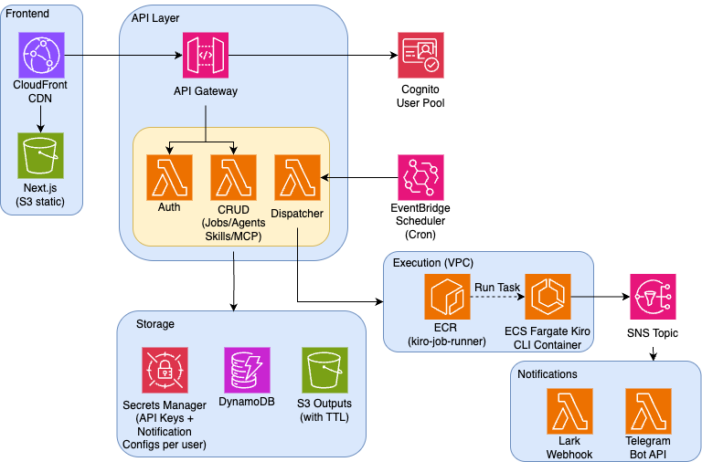

# Kiro CLI Job Scheduler

[English](README.md) | 中文

一个基于 AWS 托管基础设施的服务端编排平台，用于定时调度和执行 [Kiro CLI](https://kiro.dev/cli/) 任务。用户可以定义自定义 Agent（含 Prompt、模型、工具、Skills、MCP 服务器），然后按 Cron 表达式自动执行——也支持通过 Docker Compose 在本地运行。

> [!WARNING]
> 本项目为示例代码，仅用于演示和学习目的，**不适合直接用于生产环境**，在用于生产前应先经过审查、测试和加固。部署本栈会创建可能产生费用的 AWS 资源——使用完毕后请按 [资源清理](#资源清理) 步骤销毁。

## 功能特性

- **定时任务** — 基于 Cron 表达式调度（如"每个工作日早上9点"），由 AWS EventBridge 驱动
- **Agent 配置** — 自定义 Agent，包含 Prompt、模型选择、工具、Skills 和 MCP 服务器
- **Skills 管理** — 创建可复用的 Skill 文档（Markdown），可挂载到任意 Agent
- **MCP 服务器** — 配置 stdio 和 HTTP 类型的 MCP 服务器，跨 Agent 复用
- **用户级 API Key 隔离** — 每个用户的任务使用自己的 KIRO CLI 身份运行（存储在 Secrets Manager）
- **Web UI** — 面向非技术用户的专业仪表盘（Next.js + shadcn/ui）
- **通知** — 任务完成/失败时通过飞书 Webhook 和 Telegram Bot 发送通知
- **本地模式** — 通过 Docker Compose + LocalStack 在本地运行完整系统

## 系统架构



### 任务执行流程

1. 用户通过 UI 创建任务（Prompt、调度规则、Agent 配置）
2. API 将任务存入 DynamoDB，创建 EventBridge Schedule
3. 触发时间到达时，EventBridge 调用 Dispatcher Lambda
4. Dispatcher 解析完整 Agent 配置（获取 Skills、MCP 服务器配置）
5. Dispatcher 启动 ECS Fargate 任务，容器从 Secrets Manager 获取 `KIRO_API_KEY`
6. 容器执行 `kiro-cli chat --no-interactive --trust-all-tools --agent job-agent "<prompt>"`
7. 执行完成后，输出上传到 S3，状态更新到 DynamoDB
8. SNS 通知触发飞书/Telegram Lambda 发送告警

## 项目结构

```
kiro-job-scheduler/
├── packages/
│   ├── shared/          # TypeScript 类型 + Zod 校验
│   ├── api/             # Lambda 处理函数（认证、CRUD、调度、通知）
│   ├── web/             # Next.js 前端（App Router + Tailwind）
│   └── infra/           # AWS CDK 基础设施
├── terraform/           # Terraform 部署（替代 CDK）
├── docker/
│   ├── Dockerfile       # Kiro CLI 任务执行容器（Amazon Linux 2023）
│   ├── entrypoint.sh    # 任务执行脚本
│   ├── Dockerfile.api   # 本地 API 服务
│   └── Dockerfile.web   # 本地前端服务
├── docker-compose.yml   # 本地开发环境
└── .github/workflows/   # CI/CD 流水线
```

## 前置要求

- Node.js 20+
- pnpm 9+
- Docker（本地模式）
- AWS CLI + CDK CLI 或 Terraform（部署到 AWS）
- [Kiro Pro/Pro+/Power](https://kiro.dev/pricing/) 订阅（用于 API Key）

## 快速开始（本地模式）

```bash
# 克隆并安装
git clone <repo-url> && cd sample-kiro-cli-job-scheduler
pnpm install
pnpm build

# 启动本地环境（LocalStack + API + Web + Worker）
docker compose up

# 访问 http://localhost:3000
```

本地环境使用 LocalStack 模拟 DynamoDB、S3、Secrets Manager 和 SNS，无需 AWS 账号即可开发。

## AWS 部署

### 方式一：Terraform（推荐）

```bash
cd terraform
cp terraform.tfvars.example terraform.tfvars  # 按需修改
./deploy.sh
```

**terraform.tfvars 配置项：**

| 变量 | 默认值 | 说明 |
|------|--------|------|
| `region` | `us-east-1` | AWS 部署区域 |
| `project` | `kiro-scheduler` | 项目名称前缀（用于所有资源命名） |
| `environment` | `prod` | 环境标识 |
| `existing_vpc_id` | `""` (空) | 使用已有 VPC 的 ID。留空则自动创建新 VPC |
| `existing_subnet_ids` | `[]` (空) | 已有 VPC 中的子网 ID 列表（需有互联网出站能力）。设置 `existing_vpc_id` 时必填 |

示例 — 使用已有 VPC：
```hcl
region              = "us-east-1"
project             = "kiro-scheduler"
existing_vpc_id     = "vpc-0123456789abcdef0"
existing_subnet_ids = ["subnet-aaa111", "subnet-bbb222"]
```

`deploy.sh` 会自动完成：构建项目 → 打包 Lambda → 创建 Terraform 状态桶 → 部署基础设施 → 构建并推送 Docker 镜像。

### 方式二：CDK

```bash
cd packages/infra
npx cdk bootstrap  # 首次部署
npx cdk deploy --all
```

### 部署前端

```bash
cd packages/web

# 从 Terraform 输出创建 .env.local
cat > .env.local <<EOF
NEXT_PUBLIC_API_URL=$(cd ../../terraform && terraform output -raw api_endpoint)
NEXT_PUBLIC_COGNITO_USER_POOL_ID=$(cd ../../terraform && terraform output -raw cognito_user_pool_id)
NEXT_PUBLIC_COGNITO_CLIENT_ID=$(cd ../../terraform && terraform output -raw cognito_client_id)
EOF

# 构建静态站点
pnpm build

# 上传到 S3
FRONTEND_BUCKET=$(cd ../../terraform && terraform output -raw frontend_bucket)
aws s3 sync out/ s3://$FRONTEND_BUCKET/ --delete

# 刷新 CloudFront 缓存
CF_DOMAIN=$(cd ../../terraform && terraform output -raw cloudfront_domain)
CF_DIST_ID=$(aws cloudfront list-distributions \
  --query "DistributionList.Items[?DomainName=='${CF_DOMAIN}'].Id" --output text)
aws cloudfront create-invalidation --distribution-id $CF_DIST_ID --paths "/*"
```

> 参见 `packages/web/.env.example` 了解所有可用环境变量。

### 前端环境变量

| 变量 | 说明 |
|------|------|
| `NEXT_PUBLIC_API_URL` | API Gateway 端点 URL |
| `NEXT_PUBLIC_COGNITO_USER_POOL_ID` | Cognito User Pool ID |
| `NEXT_PUBLIC_COGNITO_CLIENT_ID` | Cognito App Client ID |

## API 接口

| 方法 | 路径 | 说明 |
|------|------|------|
| GET | `/auth/me` | 获取当前用户信息 |
| GET/PUT/DELETE | `/settings/api-key` | 管理 KIRO API Key |
| GET/POST | `/agents` | 列表/创建 Agent 配置 |
| GET/PUT/DELETE | `/agents/:id` | 获取/更新/删除 Agent |
| GET/POST | `/skills` | 列表/创建 Skills |
| GET/PUT/DELETE | `/skills/:id` | 获取/更新/删除 Skill |
| GET/POST | `/mcp-servers` | 列表/创建 MCP 服务器配置 |
| GET/PUT/DELETE | `/mcp-servers/:id` | 获取/更新/删除 MCP 服务器 |
| GET/POST | `/jobs` | 列表/创建定时任务 |
| GET/PUT/DELETE | `/jobs/:id` | 获取/更新/删除任务 |
| POST | `/jobs/:id/run` | 手动触发任务 |
| GET | `/jobs/:id/executions` | 查看任务执行历史 |

## 安全设计

- **API Key 隔离**：每个用户的 KIRO_API_KEY 存储在 Secrets Manager 的用户级路径下，容器运行时从 Secrets Manager 动态获取，不以明文传递
- **租户隔离**：所有 DynamoDB 查询以 `userId` 为分区键，用户无法访问他人资源
- **KMS 加密**：DynamoDB 表和 S3 桶均使用 KMS 密钥加密，密钥自动轮换
- **网络隔离**：ECS 任务运行在安全组内，仅允许出站 HTTPS（443）和 DNS（53）
- **Cognito 认证**：JWT 令牌认证 + API Gateway 授权器

## 成本估算

基于 **ap-northeast-1（东京）** 区域，典型使用场景（每天 5 个任务，每次约 2 分钟，0.5 vCPU / 1 GB）：

| 服务 | 用量 | 月费用 |
|------|------|--------|
| ECS Fargate | 5 任务 × 2 分钟 × 30 天 | $0.15 |
| Lambda | ~1,000 次调用（免费额度内） | $0.00 |
| DynamoDB | ~5K 写 + 10K 读（按需模式） | $0.01 |
| S3 | ~15 MB（前端 + 输出） | $0.00 |
| CloudFront | ~1 GB 流量 | $0.11 |
| Cognito | 1 用户（免费额度：50K MAU） | $0.00 |
| EventBridge Scheduler | 免费 | $0.00 |
| SNS | ~150 条消息（免费额度内） | $0.00 |
| Secrets Manager | 2 个密钥 × $0.40 | $0.80 |
| KMS | 1 个 CMK | $1.00 |
| ECR | ~600 MB 镜像 | $0.06 |
| CloudWatch Logs | ~100 MB | $0.07 |
| **合计** | | **~$2.20** |

> 💡 空闲成本（无任务运行时）：约 $1.86/月（仅 Secrets Manager + KMS + ECR 存储费）。Fargate 无任务时不收费。

## 资源清理

使用完毕后，请销毁所有资源以避免持续计费。

### Terraform

```bash
cd terraform
terraform destroy
```

### CDK

```bash
cd packages/infra
npx cdk destroy --all
```

部分资源在销毁后可能需要手动处理：

- 含对象的 **S3 桶** 和含镜像的 **ECR 仓库** 可能需要先清空才能删除。
- **KMS 密钥** 会进入删除等待期（7–30 天）后才真正删除，而非立即删除。
- 请在 AWS 控制台确认 DynamoDB 表、Cognito 用户池和 CloudWatch 日志组已被删除。

## 许可证

本项目基于 MIT-0 许可证授权。详见 [LICENSE](LICENSE) 文件。
